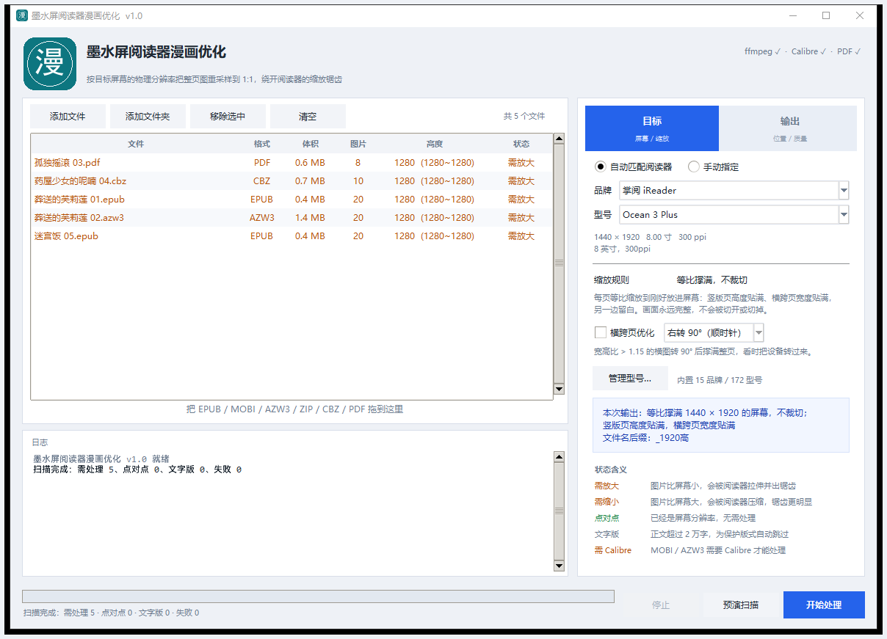

<div align="center">
  
  <h1>墨水屏阅读器漫画优化</h1>
  <p><b>把整页漫画重采样到你设备的物理分辨率，让阅读器不再插手缩放</b></p>
  <p>
    
    
    
  </p>
</div>



---

## 它解决什么问题

墨水屏阅读器显示漫画时，如果图片分辨率和屏幕对不上，阅读器就得自己做缩放。而阅读器用的往往是**最近邻**或**双线性**这类廉价算法，在只有黑白灰的墨水屏上，代价很直观：

- **图片比屏幕小** → 放大后线条边缘出现阶梯状锯齿，网点糊成一团灰
- **图片比屏幕大** → 压缩后细线断裂、网点出现摩尔纹，反而更脏

解决办法很简单：**在电脑上先把图重采样到正好等于屏幕的像素数**。阅读器拿到 1:1 的图就不需要动它，直接按像素点对点显示，锯齿和摩尔纹自然消失。

这个工具做的就是这件事——批量、自动化、支持主流电子书格式，并且会连 EPUB 内部的尺寸声明一起改（否则阅读器仍会把图缩回去）。

## 功能

- **格式覆盖**：EPUB / ZIP / CBZ / PDF / MOBI / AZW3 / AZW —— 直接吃原始文件，输出同格式
- **机型自动匹配**：内置 **15 个品牌 / 172 个型号** 的真实屏幕参数，选完型号自动得到目标分辨率
- **手动指定**：也可以直接填自己的屏幕宽高
- **不裁切**：等比撑满，画面永远完整，绝不切开或切掉
- **横跨页优化**（可选）：宽幅跨页自动转 90°，配合"把设备转过来看"，比捏合缩放舒服得多
- **文字书保护**：自动识别纯文字书并跳过，避免改坏版心
- **参数记忆**：品牌、型号、输出方式、算法、窗口位置全部记住，下次打开即上次状态
- **拖拽导入**：文件可以直接拖进窗口，也可以拖到 EXE 图标上打开
- **单文件 EXE**：免安装，25 MB，不写注册表

## 支持的格式

| 格式 | 处理方式 | 说明 |
|---|---|---|
| **EPUB** | 解包 → 缩放图片 → 改写 CSS/HTML 尺寸声明 → 重打包 | 保持 `mimetype` 为首条且不压缩 |
| **ZIP / CBZ** | 解包 → 缩放 → 重打包 | 保持原目录结构 |
| **PDF** | 优先提取页面内嵌原图再缩放，提取不到才整页渲染 | 输出按 72 dpi 写入，1 pt = 1 px |
| **MOBI / AZW3 / AZW** | 经 Calibre `ebook-convert` 往返 EPUB | 需要安装 Calibre；不会去硬改 PDB 二进制 |

> **为什么 MOBI/AZW3 要过 Calibre**
> 这两种格式的正文是压缩流，图片索引在 MOBI 头和 NCX 里交叉引用。直接改二进制会破坏 ATPH/NCX，轻则目录错乱，重则设备打不开。宁可多一步转换，也不产出坏文件。

EPUB 这一路有几个容易漏的点，这里都处理了：

- CSS 里的 `max-width` / `max-height`（不改的话，图放大了阅读器也会缩回去）
- XHTML 里的 `<meta name="viewport" content="width=…, height=…">`
- SVG 包裹页的 `viewBox` 和 `<image width height>`（日系轻小说和漫画常用这种结构）

## 快速开始

### 方式一：直接用 EXE（推荐普通用户）

1. 到 [Releases](../../releases) 下载最新的 `墨水屏阅读器漫画优化.exe`
2. 双击运行。首次启动请让 Windows Defender 的 SmartScreen 选「更多信息 → 仍要运行」——单文件 EXE 没有代码签名，属于正常现象
3. 如果需要处理 MOBI / AZW3，先装 [Calibre](https://calibre-ebook.com/download_windows)；处理其余格式不需要

### 方式二：从源码跑

```bash
git clone https://github.com/yesloli/eink-manga-resize.git
cd eink-manga-resize
pip install -r requirements.txt
python manga_resize.py
```

需要 Python 3.10 以上。想让缩放走 ffmpeg（更快、质量更好），把 ffmpeg 放进 PATH 即可，没装也能用 Pillow 跑，只是慢一些。

## 使用流程

1. **加文件** —— 点「添加文件」/「添加文件夹」，或者直接把文件拖进窗口
2. **等扫描** —— 表格会显示每个文件的图片张数、中位高度和状态判定（需放大 / 需缩小 / 点对点 / 文字版）
3. **选目标** —— 「自动匹配阅读器」选品牌和型号，或「手动指定」填宽高
4. **点开始处理** —— 完成后列表会自动刷新，状态变成「点对点」

## 缩放规则

只有一条规则，等价于「等比装进屏幕框，不裁切」：

```
缩放比 s = min(屏幕宽 / 图宽, 屏幕高 / 图高)
输出尺寸 = (图宽 × s, 图高 × s)
```

哪个方向先到边就由哪个方向决定，另一边等比留白。以 1440 × 1920 的屏幕为例：

| 原图 | 输出 | 结果 |
|---|---|---|
| 895 × 1280（普通单页） | 1342 × 1920 | 高度贴满，左右留白 |
| 1000 × 1000（方图） | 1440 × 1440 | 宽度贴满，上下留白 |
| 2000 × 1000（横跨页） | 1440 × 720 | 宽度贴满，上下留白 |
| 1342 × 1920（已适配） | 1342 × 1920 | 判定点对点，跳过不动 |

> 早先版本提供过「高度对齐 / 宽度对齐 / 完整适配」三个选项，后来发现加上溢出保护之后三者化简是同一个 `min()`，等于三个按钮一个行为，已合并为单一规则。

### 横跨页优化（可选）

勾选后，宽高比大于 1.15 的横向图片会先转 90°，再按竖图撑满整页——于是跨页能占到近乎整个屏幕，而不是被压成一条。旋转在缩放之前用 ffmpeg 的 `transpose` 滤镜一次完成，不会二次重采样。

触发条件（三者同时满足）：开关打开、目标是竖屏、图片宽 ≥ 高 × 1.15。

日漫跨页是右页在前，转过来后从下往上读；方向反了就换成「左转 90°」。

## 输出方式

| 方式 | 结果 |
|---|---|
| 与源文件同目录，名字加后缀 | `A.epub` → `A_1920高.epub` |
| 放到指定目录 | 输出到指定目录，文件名同样加后缀 |
| 直接覆盖源文件（名字不变） | 原地替换，文件名一个字都不改 |

三种方式都是**先写临时文件、成功后再原子替换**。中途失败时原文件原样保留，不会出现"旧的删了新的没写成"。

原地覆盖不可逆，点击开始前会二次确认；已经点对点的文件会自动跳过，不会被无意义地重编码一遍。

## 机型库

内置 **15 个品牌 / 172 个型号**：

| 品牌 | 型号数 | 品牌 | 型号数 |
|---|---:|---|---:|
| 掌阅 iReader | 44 | 汉王 Hanvon | 11 |
| 文石 BOOX | 34 | 小米 / 多看 | 5 |
| Amazon Kindle | 20 | 科大讯飞 | 5 |
| Kobo | 19 | PocketBook | 5 |
| Apple iPad | 7 | 海信 Hisense | 4 |
| 安卓平板 / 手机 | 6 | 墨案 moaan | 3 |
| reMarkable | 3 | 索尼 SONY | 3 |
| 大我 Dasung | 3 | | |

数据来源与核对方式：

- **Kindle** —— 书伴 bookfere.com 的硬件参数大全（更新至 2026-08）
- **掌阅** —— 太平洋产品报价库逐型号 + 官方发布稿
- **文石 / 汉王 / Kobo / 海信 / reMarkable / 大我 / PocketBook** —— eink-crop-studio 的机型表与各家官网交叉核对
- **小米 / 科大讯飞** —— 官方发布稿与百科

每条都过了「对角线像素 ÷ 英寸 ≈ 标注 ppi」的一致性校验，偏差超过 6% 会报警。仍有 **19 个型号**存在批次差异或官方未公开像素值，标记为 `certain=False`，界面会显示橙色提示「该型号参数待核，建议以设备实测为准」。

**参数不对？** 主界面「管理型号…」里可以直接改任意型号或新增自己的设备，改完立刻生效并记住，不需要改代码。

## 外部依赖

| 依赖 | 用途 | 是否必需 |
|---|---|---|
| **ffmpeg** | 高质量缩放（swscale + spline），并发处理 | 可选。缺失时自动退回 Pillow，速度慢一些、锐度略差 |
| **Calibre** | MOBI / AZW3 往返转换 | 仅这两种格式需要，其余格式无关 |
| **pypdfium2** | PDF 解析与渲染 | 仅 PDF 需要 |

程序启动时会在右上角显示三者的探测状态。找不到可以在「输出 → 外部工具」里手动指定路径，那里还有「重新检测」和「下载 Calibre」的入口。

## 常见问题

**Q：处理完体积变大了。**
正常。原文件可能用的是很低质量的 JPEG 或者更小的分辨率。本工具默认用质量 2（高保真）重新编码，想要小一点把「图像质量」调到 3，体积约省 15%，肉眼几乎看不出差别。再往上（4 以上）会在网点区出现块状噪点，不建议。

**Q：为什么有些文件被标成「文字版」跳过了？**
正文超过 2 万字的会被判定为纯文字书。本工具会改写整份 CSS 的 `max-width/max-height`，对文字书会造成版心崩塌，所以直接跳过。这个阈值写在 `resize_core.py` 的 `TEXT_LIMIT`。

**Q：勾了「覆盖已存在的输出文件」却没覆盖？**
先看日志。三种情况会分别打印：`覆盖已有输出`、`输出已存在，跳过（未勾选覆盖）`、`输出文件被占用，无法覆盖`。第三种是目标文件正被阅读器或资源管理器预览窗格打开着，关掉再试。另外注意输出名带目标高度后缀，换了型号就会生成 `_1696高` 这种新文件名，原来的文件自然不会被改动。

**Q：长条漫（比如 5:1）处理完变得很细？**
这是当前规则的固有限制。一张 5:1 的图要放进 3:4 的屏幕，等比不裁切的话只能缩到屏幕宽度的 27%，字会小到看不清。真正的解法是**按屏幕高度切分成多页**，但那样会改变页数、影响页码和目录锚点，所以没有默认开启。如果你手头条漫很多，可以提 issue 讨论。

**Q：支持 CBR / RAR 吗？**
不支持，需要 unrar 库。可以把 CBR 先转成 CBZ，本工具支持 CBZ。

**Q：会修改原文件吗？**
默认不会——输出名带后缀，原文件不动。只有主动选择「直接覆盖源文件」才会改写，且有二次确认。

**Q：配置文件在哪？**
`%APPDATA%\MangaResize\config.json`（Windows）。删掉即可恢复出厂设置。

## 从源码构建 EXE

```bash
pip install -r requirements-dev.txt
python build_icon.py                                    # 重新生成图标（可选，仓库里已有成品）
pyinstaller --noconfirm --clean manga_resize.spec      # 产物在 dist/
```

打包配置里排除了 PyMuPDF 全家桶（会连 onnxruntime / numpy 一起拖进来，体积翻几倍），PDF 只依赖 pypdfium2。

**自检**：EXE 内置了一个无头自检入口，用来确认冻结后 ffmpeg / Calibre / pdfium / tkdnd 是否都还在：

```bash
墨水屏阅读器漫画优化.exe --selftest report.txt [可选目录]
```

## 项目结构

```
eink-manga-resize/
├── manga_resize.py       # GUI 入口（Tkinter）
├── resize_core.py        # 处理引擎：格式分派、尺寸规划、ffmpeg 并发、EPUB 改写
├── readers_db.py         # 机型数据库（15 品牌 / 172 型号）
├── build_icon.py         # 图标生成（Pillow 绘制，产出多尺寸 ico）
├── manga_resize.spec     # PyInstaller 打包配置
├── requirements.txt      # 运行时依赖
├── requirements-dev.txt  # 打包依赖
└── assets/
    ├── app.ico
    ├── app_header.png
    └── screenshots/
```

三个 Python 文件互相独立，没有第三方框架依赖，`resize_core.py` 可以单独 import 当库用：

```python
import resize_core as core

target = core.Target(1440, 1920)
opts = core.Options(ffmpeg=core.find_ffmpeg(), rotate_spread=True)
core.process_file("in.epub", "out.epub", target, opts, log=print)
```

## 已知限制

- **仅保证 Windows 10/11**。代码里没有平台绑定的逻辑，理论上 Linux / macOS 也能跑，但未测试
- **长条漫会被压小**，见 FAQ
- **CBR / RAR 不支持**
- **MOBI/AZW3 依赖 Calibre**，无 Calibre 时这两种格式会被跳过并提示，不会产出坏文件
- 机型库有 19 个型号参数待核，靠社区校正
- 单文件 EXE 无代码签名，首次运行会有 SmartScreen 提示

## 参与贡献

最需要帮忙的是**补充和校正机型参数**——如果你手上有设备，用「管理型号…」里的实际值对照一下，发现不一致就提 issue，附上品牌、型号、分辨率、屏幕尺寸即可。

欢迎 PR。改代码前建议先开 issue 说明意图，避免方向不一致。详见 [CONTRIBUTING.md](CONTRIBUTING.md)。

## 致谢

- 机型参数参考了 [bookfere.com](https://bookfere.com)、[太平洋产品报价库](https://product.pconline.com.cn/ebook/)、[eink-crop-studio](https://github.com/Estela-Zelin84/eink-crop-studio) 以及各厂商官网
- 缩放由 [FFmpeg](https://ffmpeg.org) 的 swscale 完成
- PDF 渲染用 [pypdfium2](https://github.com/pypdfium2-team/pypdfium2)（PDFium）
- MOBI/AZW3 转换用 [Calibre](https://calibre-ebook.com)

## License

[MIT](LICENSE)

---

<div align="center"><sub>English: A batch image resizer that rescales manga pages to your e-ink device's native resolution, so the reader never has to scale them itself. Supports EPUB / ZIP / CBZ / PDF / MOBI / AZW3, with a built-in database of 172 e-reader models. GUI in Chinese; code and comments are in Chinese too.</sub></div>
